# Explore Mundo (Flutter)

Trabalho prático da disciplina **DGT2812 - Desenvolvimento de Aplicativos Móveis com Flutter** (Estácio),
missão "Posso criar um App de outra forma!".
Aluno: Gabriel Cosso

App da agência de viagens Explore Mundo (caso do enunciado), feito em Flutter. O mesmo código gera o app Android e o
site complementar que a agência pediu.

- Site: https://biel-cosso.github.io/explore-mundo-flutter/
- Documentação com os prints: [docs/Documentacao-DGT2812.pdf](docs/Documentacao-DGT2812.pdf)

## Prints

<table>
  <tr>
    <td align="center">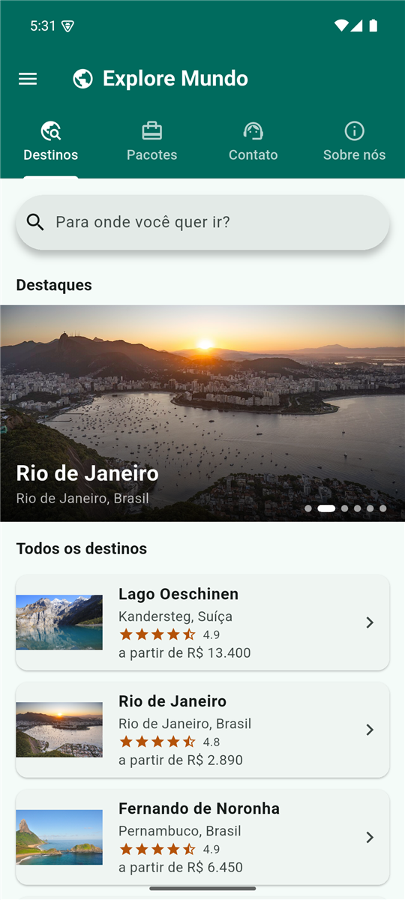<br>Início</td>
    <td align="center">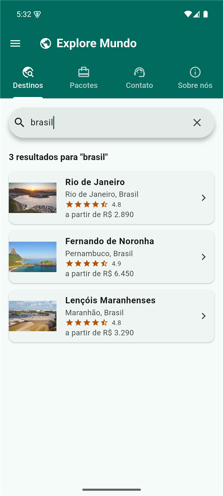<br>Pesquisa</td>
    <td align="center">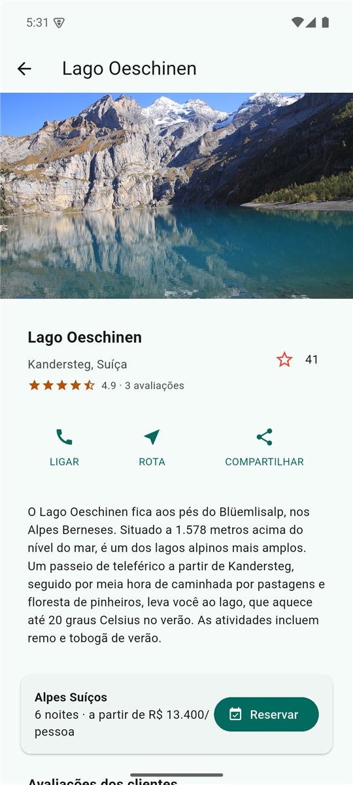<br>Destino</td>
    <td align="center">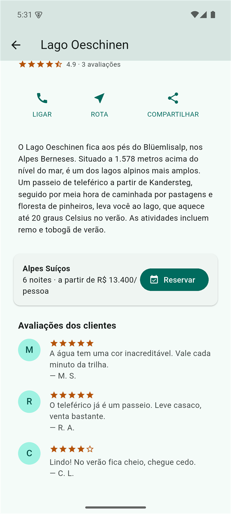<br>Avaliações</td>
  </tr>
  <tr>
    <td align="center">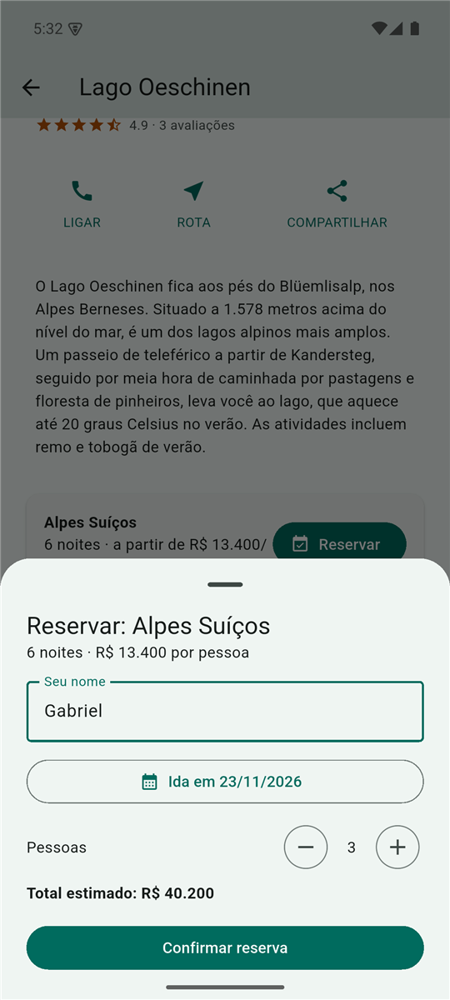<br>Reserva</td>
    <td align="center">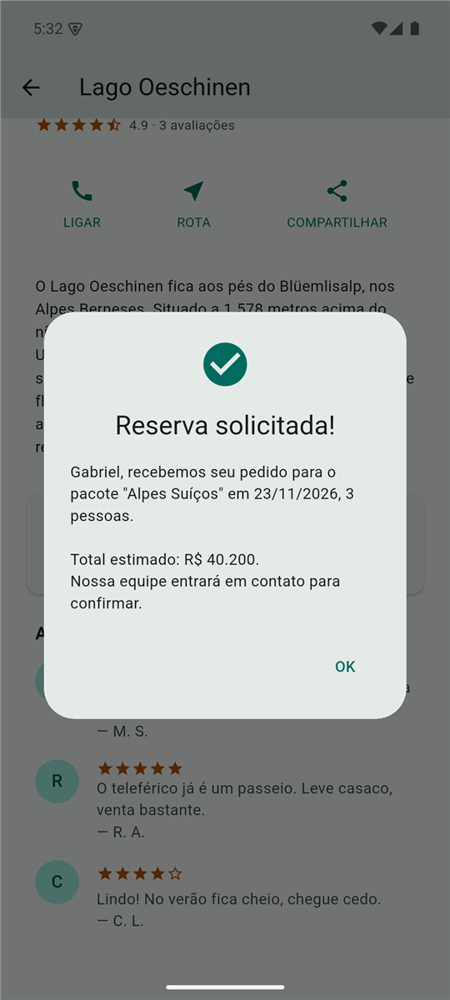<br>Reserva solicitada</td>
    <td align="center">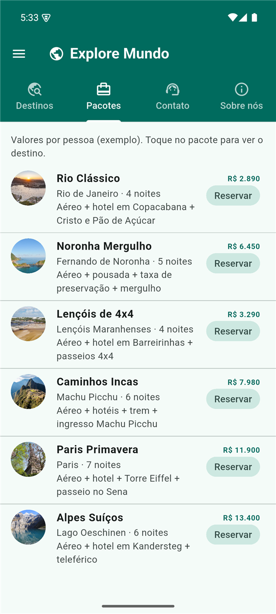<br>Pacotes</td>
    <td align="center">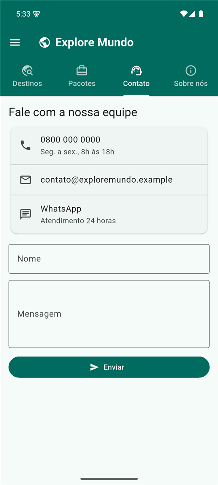<br>Contato</td>
  </tr>
  <tr>
    <td align="center">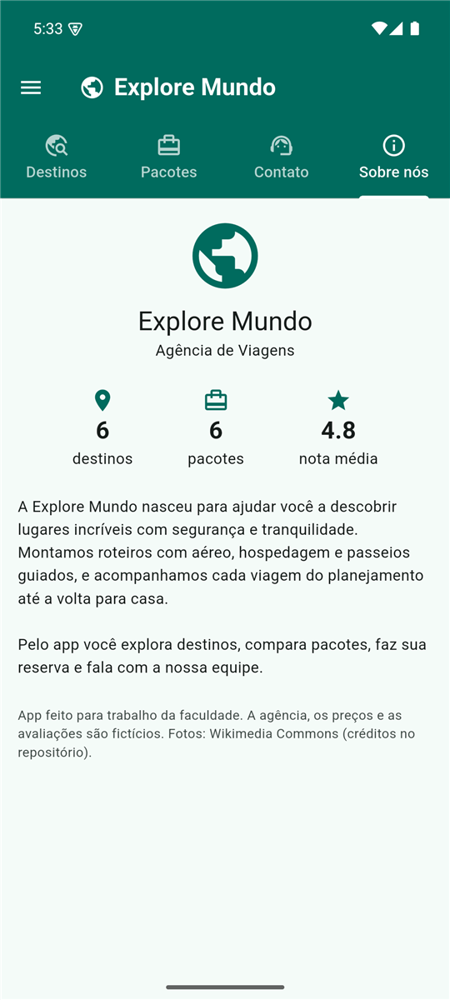<br>Sobre nós</td>
    <td align="center">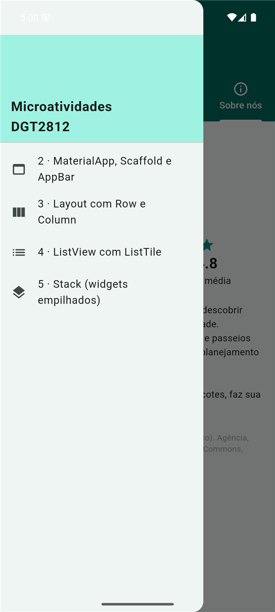<br>Menu das microatividades</td>
    <td align="center">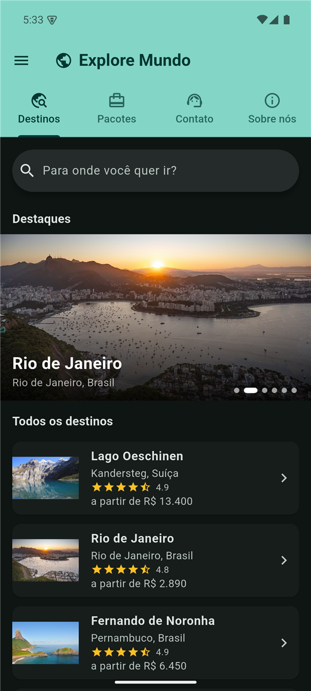<br>Tema escuro</td>
    <td align="center">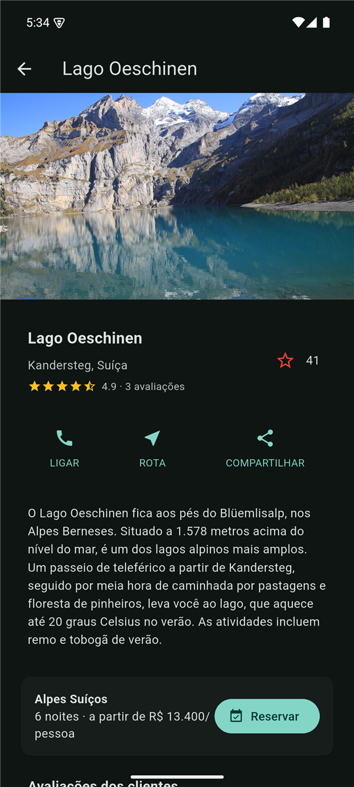<br>Destino no tema escuro</td>
  </tr>
</table>

Microatividades 2 a 5:

<table>
  <tr>
    <td align="center">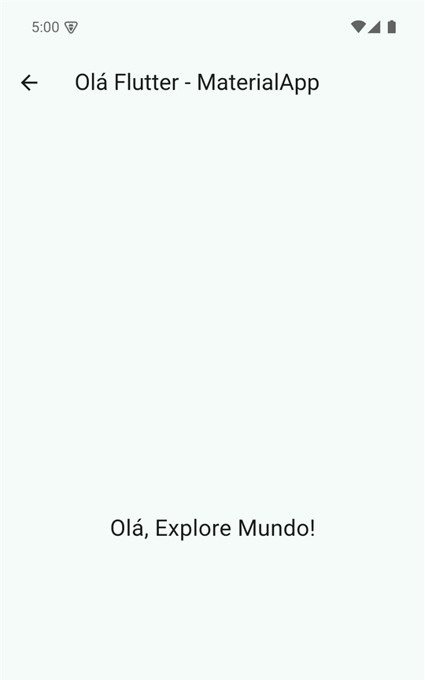<br>MaterialApp, Scaffold e AppBar</td>
    <td align="center">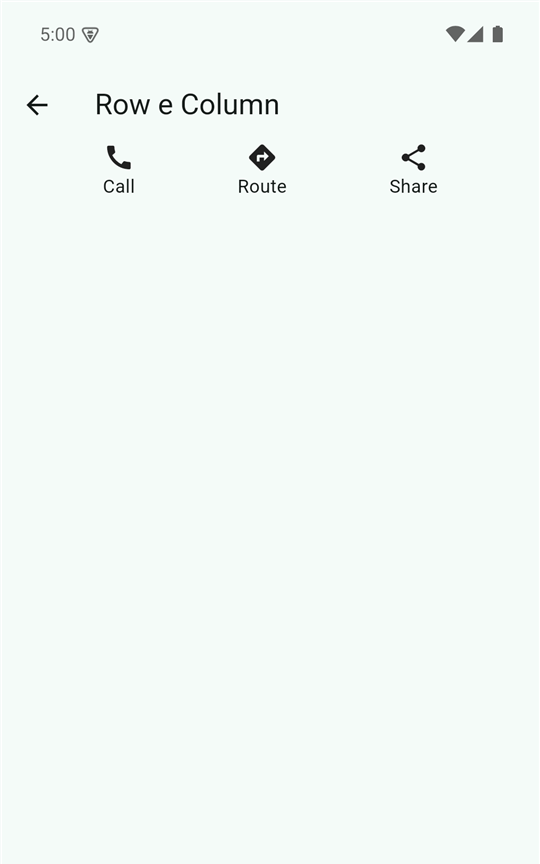<br>Row e Column</td>
    <td align="center">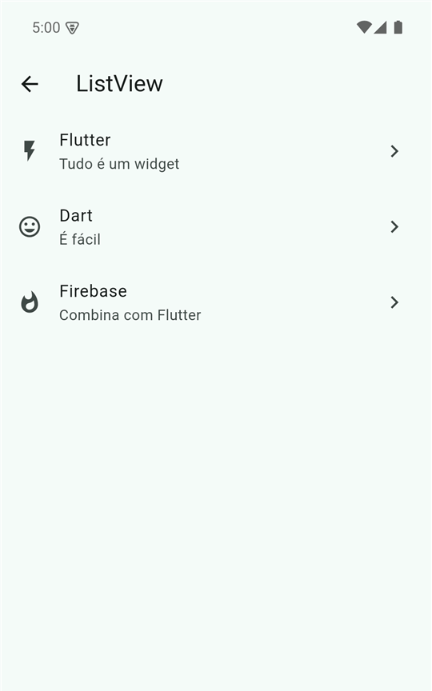<br>ListView</td>
    <td align="center">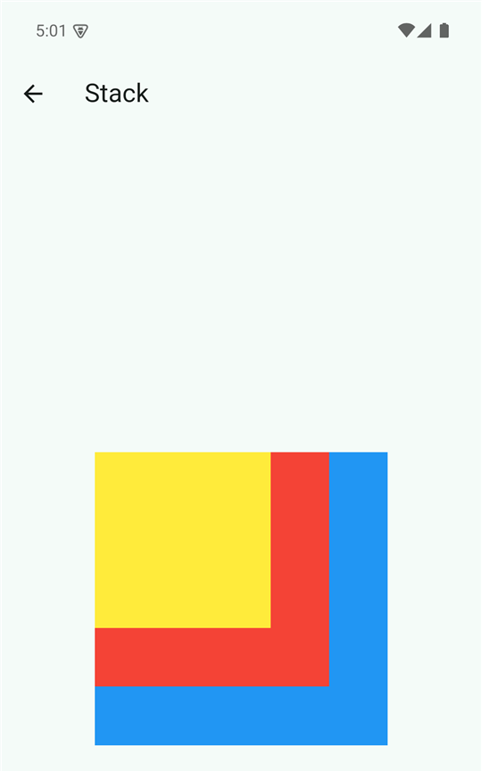<br>Stack</td>
  </tr>
</table>

Site (versão web):

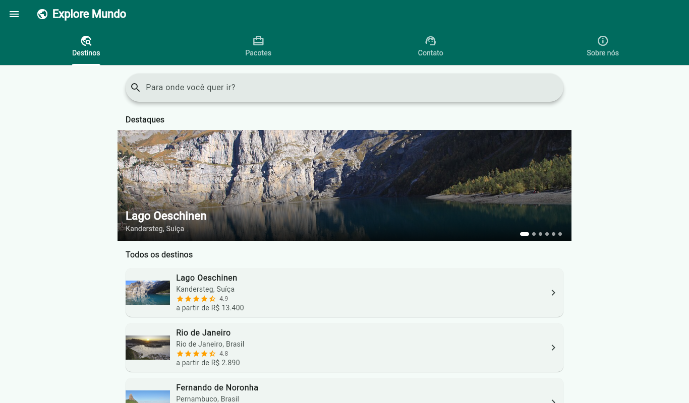

## O que tem no app

- Banner de destaque com fotos dos destinos que trocam sozinhas, tocar na foto abre o destino
- Barra de navegação com Destinos, Pacotes, Contato e Sobre nós
- Pesquisa rápida (procura no nome, país e descrição, sem ligar para acento)
- Página de cada destino montada como no roteiro (passos 5 a 9): foto, título, botões LIGAR/ROTA/COMPARTILHAR e texto,
  tudo dentro de uma ListView. Também mostra as avaliações dos clientes
- Estrela de favorito que soma/desfaz (a "funcionalidade personalizada" pedida nos objetivos)
- Reserva com nome, data e número de pessoas, calculando o total
- Menu lateral com uma tela para cada microatividade (2 a 5)
- Tema claro e escuro, seguindo o celular

## Pastas

```
lib/main.dart            MaterialApp, tema e a tela principal com as abas
lib/dados.dart           destinos, pacotes e avaliações
lib/telas/               uma tela por arquivo (inicio, destino, pacotes, contato, sobre, microatividades)
lib/widgets/             banner, favorito e formulário de reserva
images/                  fotos dos destinos (créditos em images/CREDITOS.md)
test/                    testes
```

## Como rodar

```
flutter pub get
flutter run              (com o emulador Android aberto)
flutter run -d chrome    (versão web)
flutter test             (testes)
```

## Observações

- O `RaisedButton` citado nos objetivos foi removido do Flutter, então usei os botões novos (`FilledButton` e
  `ElevatedButton`).
- A agência, os preços, as avaliações e os contatos são inventados para o trabalho. A reserva e o formulário de contato
  não enviam nada, só mostram a confirmação.
- As fotos são do Wikimedia Commons, com licenças livres. Os autores estão em `images/CREDITOS.md`.
